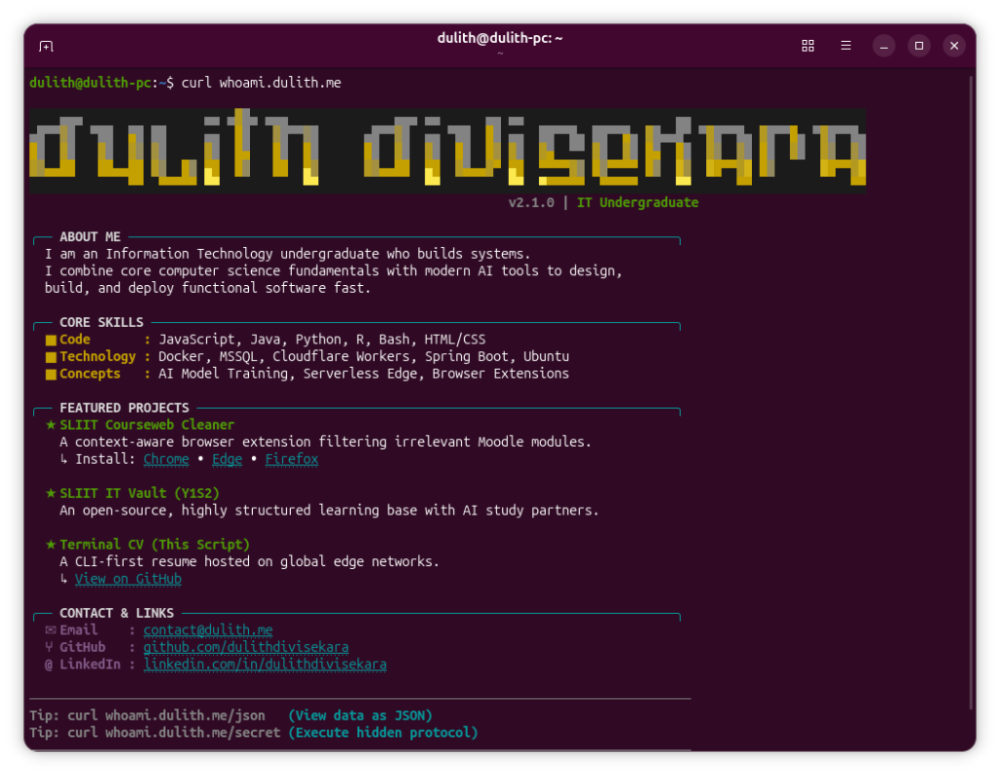

<p align="center">
  <h1 align="center">Dulith Divisekara</h1>
</p>

<p align="center">
  <a href="https://readme-typing-svg.demolab.com">
    
  </a>
</p>

<p align="center">
  <a href="#"></a>
  <a href="https://dulith.me"></a>
  <a href="mailto:contact@dulith.me"></a>
  <a href="https://linkedin.com/in/dulithdivisekara"></a>
  <a href="https://github.com/dulithdivisekara"></a>
</p>

<p align="center">
  <a href="#interactive-terminal-resume">Terminal CV</a> &bull;
  <a href="#featured-systems">Featured Systems</a> &bull;
  <a href="#published-browser-extensions">Published Extensions</a> &bull;
  <a href="#technical-arsenal">Tech Arsenal</a> &bull;
  <a href="#academic-background">Education</a> &bull;
  <a href="#contact">Contact</a>
</p>

---

## Interactive Terminal Resume

Query my serverless edge portfolio deployed across Cloudflare Workers directly from your shell:

```bash
curl -s whoami.dulith.me
```

<p align="center">
  
</p>

<details>
  <summary><b>View Advanced Shell Endpoints</b></summary>
  <br>

  | Target | Shell Command | Description |
  | :--- | :--- | :--- |
  | **Structured JSON** | `curl -s whoami.dulith.me/json` | Machine-readable JSON payload of background and capabilities |
  | **Hidden Protocol** | `curl -s whoami.dulith.me/secret` | Encrypted connection easter egg and direct protocol note |
</details>

---

## Featured Systems

| System | Architecture & Engineering Focus | Primary Stack | Repository |
| :--- | :--- | :--- | :--- |
| **TP-Link Router Suite & MCP** | Universal production CLI and Model Context Protocol (FastMCP 2.x) server enabling AI copilots to programmatically inspect and configure routers (LTE band locks, BBR congestion control, USSD, SMS). | Python, FastMCP, Socket, Linux | [](https://github.com/dulithdivisekara/tplink-router-builder) |
| **Terminal Edge CV** | Zero-dependency serverless resume running on V8 edge isolates with dual-surface routing: native ANSI for shell clients and automated redirects for web browsers. | JavaScript, Cloudflare Workers, Fetch API | [](https://github.com/dulithdivisekara/terminal-cv) |
| **SLIIT CourseWeb Cleaner** | Context-aware Moodle optimization platform filtering unassigned campus modules, injecting custom dark mode, and deployed across major official browser extension stores. | JavaScript, DOM, CSS, WebExtensions API | [](https://github.com/dulithdivisekara/sliit-courseweb-cleaner) |
| **SLIIT CourseWeb MCP Server** | Autonomous Model Context Protocol (MCP) server for SLIIT CourseWeb (Moodle), bridging course documents, assignments, and announcements directly to AI assistants. | Python, MCP Protocol, Moodle API | [](https://github.com/dulithdivisekara/mcp-sliit-courseweb) |
| **Enterprise Pharmacy Platform** | Full-stack prescription verification and pharmacist triage platform with Dockerized containerization and relational database modeling. | Java, Jakarta EE, PostgreSQL, Docker | [](https://github.com/dulithdivisekara/drug-ordering-system) |
| **MovieLens Classifier Benchmark** | Empirical evaluation and variance analysis of 6 classification architectures on MovieLens 32M using stratified k-fold cross-validation. | Python, Scikit-learn, Pandas, Jupyter | [](https://github.com/dulithdivisekara/movielens-satisfaction-prediction) |

---

## Published Browser Extensions

### SLIIT CourseWeb Cleaner
*A context-aware browser extension published across official web stores to optimize the SLIIT CourseWeb (Moodle) ecosystem.*

| Store / Platform | Distribution Status | Direct Access |
| :--- | :--- | :--- |
| **Google Chrome Web Store** | Published & Live | [Install Extension on Chrome Web Store](https://chromewebstore.google.com/detail/sliit-courseweb-cleaner/lnoadlfhebmkhmbfmehdgoffjllgadjm?authuser=0&hl=en-GB) |
| **Mozilla Firefox Add-ons** | Published & Live | [Install Add-on on Firefox AMO](https://addons.mozilla.org/en-US/firefox/addon/sliit-courseweb-cleaner/) |
| **Microsoft Edge Add-ons** | Published & Live | [Install Add-on on Edge Add-ons](https://microsoftedge.microsoft.com/addons/detail/sliit-courseweb-cleaner/gmlodfhgiopjgamoijjffcmgfenkkkhe) |
| **Documentation Portal** | Hosted on Cloudflare Pages | [Explore Documentation & Releases](https://sliit-courseweb-cleaner-web.pages.dev/) |

---

## Technical Arsenal

<p align="center">
  <a href="https://skillicons.dev">
    
  </a>
</p>

### Network Inspection & Security Tooling
- **Traffic Analysis & Protocols**: Packet inspection, protocol analysis, reverse-engineering client/WebSocket APIs, Wireshark, TCP/IP, DNS, AT commands
- **Security Engineering**: Access control, credential segregation, secure token handling, network diagnostic instrumentation

### Systems & Edge Infrastructure
- **Runtimes & Cloud**: Cloudflare Workers (V8 isolates), Linux (Ubuntu, Debian), Docker containerization, Model Context Protocol (FastMCP)
- **Tool Development**: Command-line interfaces (CLI), socket automation, system scripts (Bash)

### Backend Engineering & Data
- **Languages**: Python, Java, JavaScript, SQL, Bash, R
- **Data Stores**: PostgreSQL, Supabase, MSSQL, SQLite

---

## Academic Background

**Sri Lanka Institute of Information Technology (SLIIT)**  
*BSc (Hons) in Information Technology - Specializing in Cyber Security*  
- Campus: Malabe, Sri Lanka
- Academic Focus: Network security, system administration, secure software architectures, and automated threat mitigation

---

## Contact

Professional inquiries and collaboration:

- **Web**: [dulith.me](https://dulith.me)
- **Direct Email**: [contact@dulith.me](mailto:contact@dulith.me)
- **LinkedIn**: [linkedin.com/in/dulithdivisekara](https://linkedin.com/in/dulithdivisekara)
- **GitHub**: [github.com/dulithdivisekara](https://github.com/dulithdivisekara)
